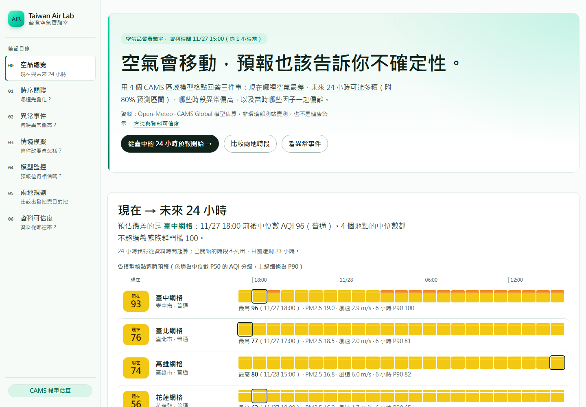
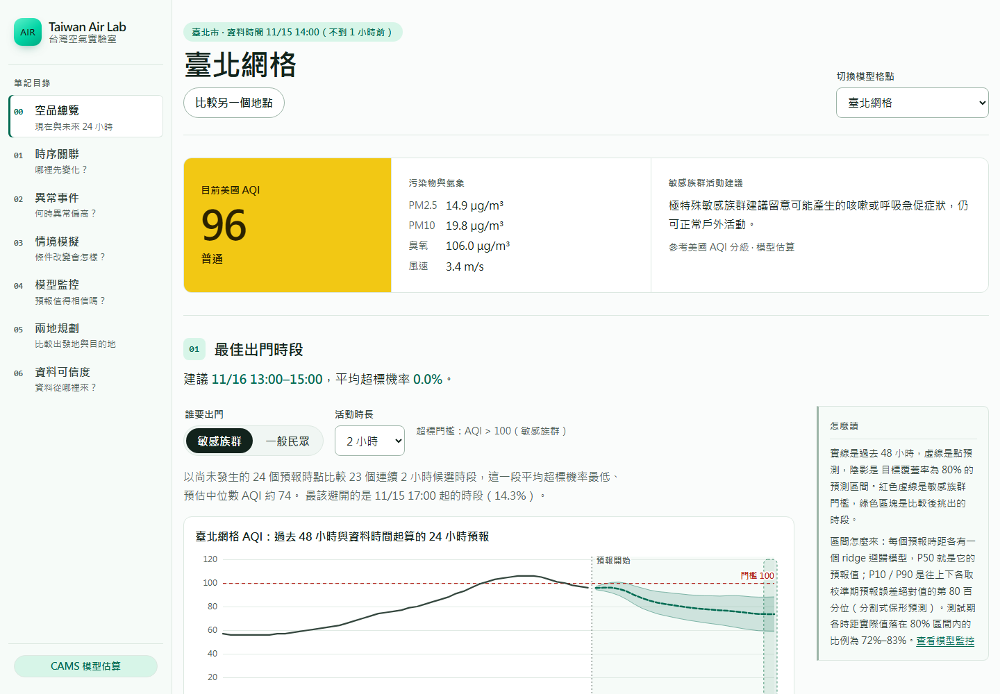
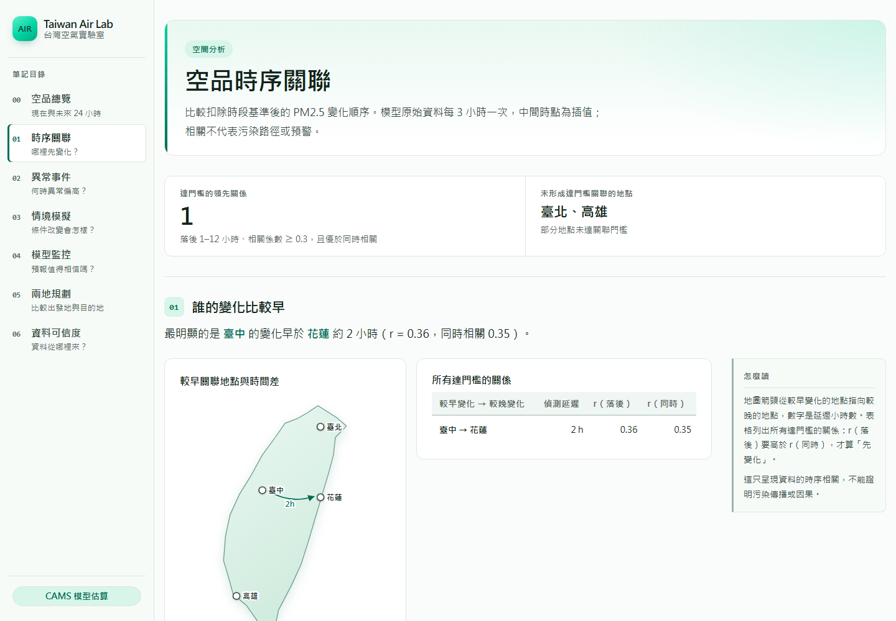
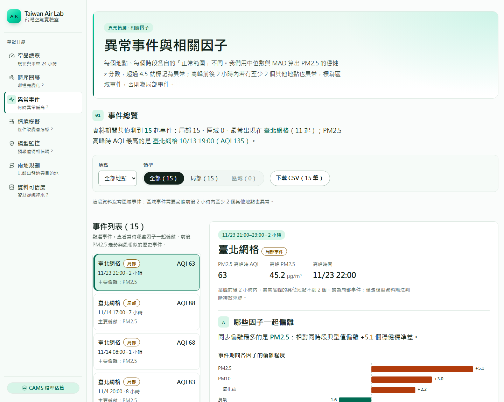
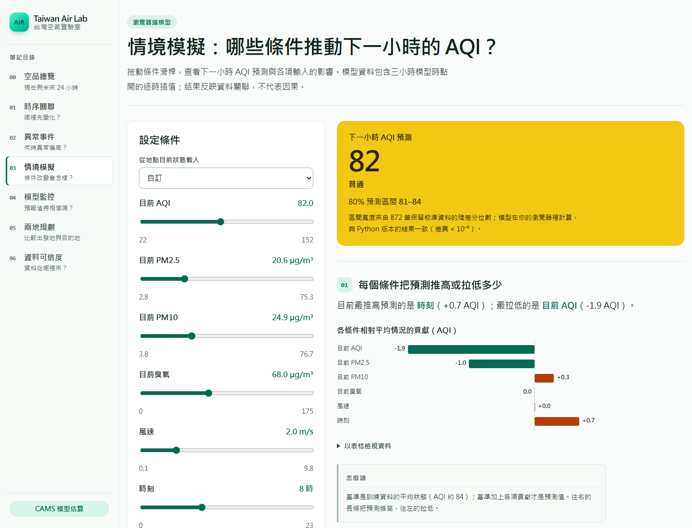
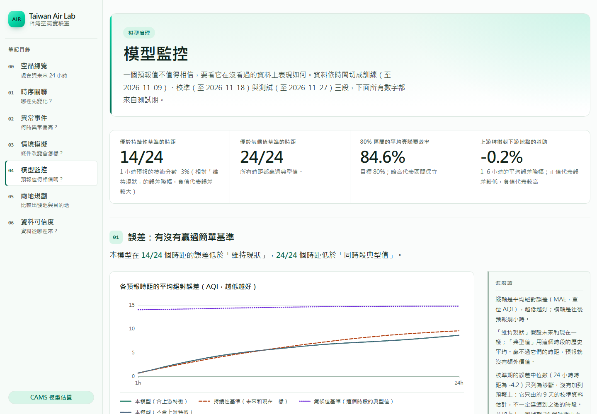
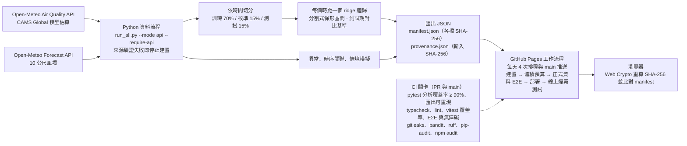

# Taiwan Air Lab

[](https://github.com/Lily09-project/aqi-anomaly-dashboard/actions/workflows/quality.yml)
[](https://github.com/Lily09-project/aqi-anomaly-dashboard/actions/workflows/security.yml)

臺灣空品趨勢、異常與情境分析展示網站：用臺北、臺中、高雄、花蓮四個模型格點，看 AQI 怎麼變化、何時異常，以及預報有多不確定。

**[開啟線上展示](https://lily09-project.github.io/aqi-anomaly-dashboard/)**

| 桌面版 | 手機版 |
| --- | --- |
|  |  |

## 3 分鐘 Demo 路線

照順序點開即可，每個連結都直接帶好參數。資料每天更新 4 次，畫面上的數字會跟著變。

1. **[兩地出門規劃（臺北 × 高雄，3 小時、AQI 100、區間上界也要達標）](https://lily09-project.github.io/aqi-anomaly-dashboard/#/planner?a=%E8%87%BA%E5%8C%97%E7%B6%B2%E6%A0%BC&b=%E9%AB%98%E9%9B%84%E7%B6%B2%E6%A0%BC&hours=3&threshold=100&rule=upper)**
   看圖上兩地逐時 P50／P90 與綠色的符合時段，展開逐時預測指出 P50 與 P10–P90 區間，切換「點預測／區間上界」看結果怎麼變。重點：預報是區間而不只一個數字；區間來自分割式保形預測，並實際用在決策條件裡，只採用尚未開始的時段。
2. **[模型監控](https://lily09-project.github.io/aqi-anomaly-dashboard/#/model)**
   看訓練／校準／測試的時間切分、各時距 MAE 對「維持現狀」與「同時段典型值」兩個基準，以及 80% 區間的實際覆蓋率。重點：成績全部來自沒看過的測試期，並和簡單基準比；覆蓋率低於目標 5 個百分點就標「區間太窄」，網站照實顯示，不保證達到 80%。
3. **[異常事件（局部）](https://lily09-project.github.io/aqi-anomaly-dashboard/#/anomalies?kind=local)**
   點一起事件，看當時哪些因子一起偏離與最相似的歷史事件。重點：每個地點、每個小時各自用中位數與 MAD 算穩健 z 分數，再看高峰前後是否有至少兩個其他地點也異常，區分局部與區域事件。
4. **[時序關聯回放](https://lily09-project.github.io/aqi-anomaly-dashboard/#/propagation?frame=24)**
   拖動時間軸回放，對照表格中的落後相關與同時相關。重點：扣除時段基準後做 ±12 小時互相關，落後相關須高於同時相關才算「先變化」；頁面明講相關不等於傳播或因果。
5. **[資料可信度](https://lily09-project.github.io/aqi-anomaly-dashboard/#/data)**
   看每個資料檔逐一顯示「相符」。重點：瀏覽器用 Web Crypto 重新計算每個檔案的 SHA-256 並與 manifest 比對，另列輸入資料的 SHA-256 供追溯來源。

時間夠可再看[情境模擬](https://lily09-project.github.io/aqi-anomaly-dashboard/#/whatif)：ridge 模型在瀏覽器裡推論，以 parity 案例確認與 Python 版本一致。

## 功能

- **兩地出門規劃**：找出兩地點預測均符合門檻的共同時段；圖表並列兩地逐時 P50 與 P90 並標出符合的時段，可逐時查看預測區間、將區間上界納入門檻並下載共同時段 CSV。

- **空品總覽**：開頭是「現在 → 未來 24 小時」看板，每個地點一條逐時色帶（色塊依預報中位數 P50 的 AQI 分級，上緣細條依 P90），另有地圖與各地點目前 AQI
- **地點頁**：過去 48 小時走勢與未來 24 小時預報、80% 預測區間（P10–P90），以及出門時段規劃；只採用尚未開始的預報時段
- **時序關聯**：比較各地點扣除時段基準後的 PM2.5 變化順序，可逐時回放
- **異常事件**：以中位數與 MAD 的穩健 z 分數標記異常，依高峰前後是否有至少 2 個其他地點也異常區分局部與區域事件（篩選鈕顯示各類筆數），並列出相關因子
- **情境模擬**：拖動目前 AQI、PM2.5、風速等條件，看下一小時 AQI 預測與各輸入的影響；敏感度掃描預設顯示影響最大的條件
- **模型監控**：依時間切分訓練、校準與測試資料，和「維持現狀」「同時段典型值」兩個基準比較各時距誤差，檢查 80% 區間的實際覆蓋率，並追蹤資料漂移
- **資料可信度**：每個資料檔都在瀏覽器以 SHA-256 對照 manifest

## 畫面

| 出門時段規劃 | 時序關聯回放 |
| --- | --- |
|  |  |
| **異常事件與相關因子** | **情境模擬** |
|  |  |
| **模型監控** | |
|  | |

截圖取自正式網站的 CAMS 模型估算資料。改版上線後在 `web/` 執行 `npm run screenshots` 即可重拍，截圖清單在 `docs/screenshots/shots.json`。

## 正式資料

| 來源 | 內容 | 更新 |
| --- | --- | --- |
| [Open-Meteo Air Quality API](https://open-meteo.com/en/docs/air-quality-api)（免註冊） | CAMS Global 模型的 US AQI、PM2.5、PM10、臭氧、一氧化碳 | 每天 4 次，排程於台北時間 01:41、07:41、13:41、19:41（GitHub 排程常會延後開始） |
| [Open-Meteo Forecast API](https://open-meteo.com/en/docs) | 10 公尺風速與風向 | 同上 |

- CAMS Global 約 45 公里網格、原生每 3 小時資料，約每 12 小時更新；API 逐時輸出含插值，時序關聯與一小時預報的短期結果要留意這點。
- 預報：每個時距（1–24 小時）各一個 ridge 迴歸。P50 是模型的預報值本身；P10／P90 是往上下各加減校準期預報誤差絕對值的保形分位數（分割式保形預測）。作法的比較與取捨見[方法說明](docs/METHODS.md#區間作法的選擇)。
- 這是模型估算，不是環境部測站實測或即時健康警示。正式部署以嚴格模式驗證公開來源；合成資料只用於測試與預覽。
- Open-Meteo 免費使用限非商業用途，依 CC BY 4.0 標示 Open-Meteo 與 CAMS；使用條款見[官方說明](https://open-meteo.com/en/terms)。

## 工程重點



- **不回退、不造假**：正式建置以 `--require-api` 執行，公開來源失敗就停止，不讀舊 CSV、不改用合成資料；合成 fixture 只用於測試與 PR 預覽。
- **嚴守時間邊界**：前處理只向前填補最多 3 小時，不借用未來值；標準化參數、氣候值與預報用的上游關係都只由訓練期決定，並有測試確認改動未來資料不影響訓練結果。
- **區間誠實而非好看**：P50 是 ridge 點預測，不加校準期偏差位移；P10／P90 用校準期絕對殘差的保形分位數。作法以滾動重切比較後選定（見[方法說明](docs/METHODS.md#區間作法的選擇)），覆蓋率每次建置重新計算，未達目標就照實標示。
- **一定要贏過簡單基準**：各時距 MAE 和持續性、訓練期氣候值兩個基準在同一批測試樣本上比較，輸給基準的時距也照列。
- **資料與部署可驗證**：每個匯出檔的 SHA-256 寫進 manifest，瀏覽器載入時逐一比對；部署後再比對線上 `deployment.json` 記錄的原始碼版本，以及 index.html、JS、CSS 的雜湊。
- **Python 與瀏覽器一致**：出門規劃與情境模擬在瀏覽器端計算，以 parity 案例比對 Python 實作的結果。
- **慢手機也先看到東西**：`index.html` 內建靜態的載入畫面（品牌加載入中骨架），CSS 一到就繪製，不必等 JavaScript 下載完。模擬手機（CPU 慢 4 倍、1.6 Mbps、延遲 150 ms）的對照測試中，首次繪製從約 2.6 秒降到約 1.0 秒，版面位移維持 0；這是模擬條件，實機會有出入。
- **出問題時說人話**：每個資料檔最多等 20 秒，逾時會明說；網站每天部署 4 次，開著舊分頁的人切換頁面時會看到「網站剛更新過，請重新載入」，不會看到英文技術訊息。
- **鍵盤與讀屏友善**：切換地點後焦點留在切換器；在手機上點異常事件時，焦點會移到下方的詳情；情境模擬拖動滑桿時只朗讀預測結果，不重複朗讀整個面板。E2E 以 axe 檢查 WCAG 2.2 AA 規則，嚴重與重大違規必須為 0。
- **介面細節不加負擔**：每個頁面有自己的線條 icon，側欄、底部分頁列與首頁導覽卡共用；icon 是自繪的內嵌 SVG，不加套件也不多發請求（首屏 JS 約多 1 KB），而且只當裝飾，意思仍由文字傳達。首頁摘要卡頂端的色條依該地點的 AQI 等級上色；異常事件清單只在上下還有事件時讓邊緣漸淡，不支援的瀏覽器維持原樣。
- **main 受保護**：只能經 pull request 合併，且須通過 9 項必要檢查（Python 與網站測試、真實資料整合、相依套件與密鑰掃描、Windows 啟動器、建置），不允許刪除或強制覆寫。

Python 資料流程、React、TypeScript 與 Vite，GitHub Pages 提供靜態展示。介面是「天氣 App × 實驗筆記」：首頁先看現在到未來 24 小時，分析頁以編號章節呈現（一句由資料算出的重點、圖表、「怎麼讀」說明）。導覽依寬度切換：1200px 以上為左側目錄欄，641–1199px 為頂部導覽列，手機為附 icon 的底部分頁列。設計原則見 [DESIGN.md](DESIGN.md)，方法與限制見[方法說明](docs/METHODS.md)。

## 本機執行與驗證

需求：Python 3.12、Node.js 22。

```bash
python -m pip install -r requirements.txt -c requirements-lock-py312.txt
python run_all.py --mode sample
cd web && npm ci && npm run dev
```

公開模型資料使用 `python run_all.py --mode api --require-api`。

### 一次跑完所有關卡

```bash
run_project.bat --validate
```

Windows 上的單一指令：用範例資料跑完整資料流程，接著 pytest、bandit、ruff、pip-audit，以及網站的 typecheck、lint、vitest 覆蓋率、建置與體積預算，最後不啟動網站。不帶參數則建置後在 `http://127.0.0.1:4173` 開啟預覽。

### 網站測試

```bash
cd web
npm run typecheck && npm run lint && npm run coverage   # 型別、lint、單元測試
npm run build && npm run size                           # 建置與體積預算（首屏 JS ≤ 200 KB gzip）
npm run e2e                                             # Playwright：功能、版面與無障礙（需先 build）
```

E2E 在桌面（淺色與深色偏好）、平板與手機四種設定下執行。本機用範例資料時，`production-data.spec.ts` 會失敗，這是預期的：它要求真實的 Open-Meteo 資料，由 CI 以公開 API 資料執行。

E2E 預設使用 4173 埠，而且本機會沿用已在該埠執行的伺服器。如果另一個專案的預覽伺服器正好占用 4173，測試會連到錯的網站而大量失敗（資料檔回傳 HTML）。這時改用其他埠：

```bash
E2E_PORT=4199 npm run e2e                 # macOS / Linux / Git Bash
$env:E2E_PORT="4199"; npm run e2e         # PowerShell
```

測試與部署說明見[資料契約](docs/data-contract.md)、[GitHub Pages](docs/GITHUB_PAGES.md)及[部署指南](docs/deployment.md)。
