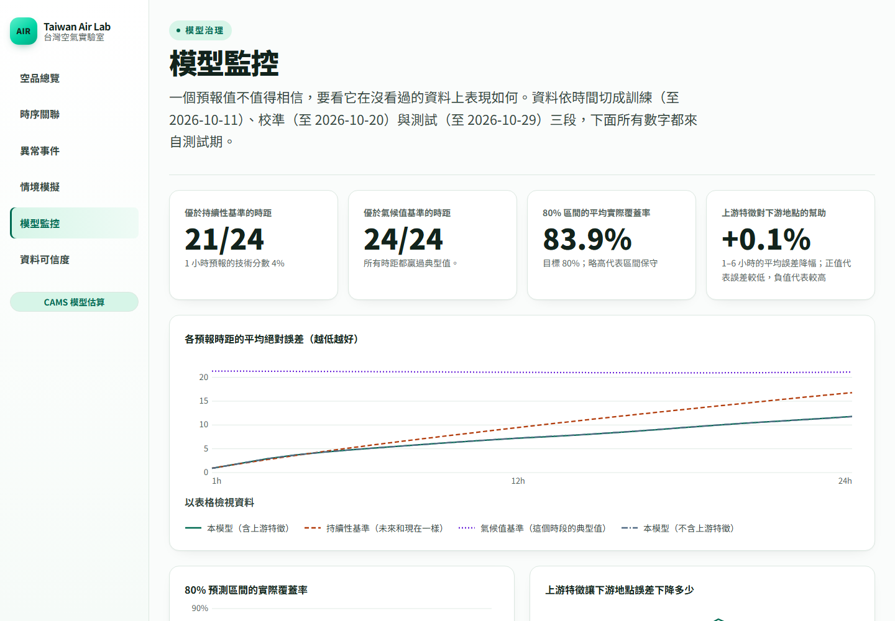

# Taiwan Air Lab

[](https://github.com/Lily09-project/aqi-anomaly-dashboard/actions/workflows/quality.yml)
[](https://github.com/Lily09-project/aqi-anomaly-dashboard/actions/workflows/security.yml)

臺灣空品趨勢、異常與情境分析展示網站：用臺北、臺中、高雄、花蓮四個模型格點，看 AQI 怎麼變化、何時異常，以及預報有多不確定。

**[開啟線上展示](https://lily09-project.github.io/aqi-anomaly-dashboard/)**

| 桌面版 | 手機版 |
| --- | --- |
|  |  |

## 功能

- **空品總覽與地點頁**：目前 AQI、地圖、未來 24 小時預報區間（P10–P90），以及出門時段規劃；只採用尚未開始的預報時段
- **時序關聯**：比較各地點扣除時段基準後的 PM2.5 變化順序，可逐時回放
- **異常事件**：以中位數與 MAD 的穩健 z 分數標記異常，區分局部與區域事件，並列出相關因子
- **情境模擬**：拖動風速、臭氧等條件，看下一小時 AQI 預測與各輸入的影響
- **模型監控**：依時間切分訓練、校準與測試資料，追蹤預報誤差與資料漂移
- **資料可信度**：每個資料檔都在瀏覽器以 SHA-256 對照 manifest

## 畫面

| 出門時段規劃 | 時序關聯回放 |
| --- | --- |
|  |  |
| **異常事件與相關因子** | **情境模擬** |
|  |  |
| **模型監控** | |
|  | |

截圖取自正式網站的 CAMS 模型估算資料。

## 正式資料

| 來源 | 內容 | 更新 |
| --- | --- | --- |
| [Open-Meteo Air Quality API](https://open-meteo.com/en/docs/air-quality-api)（免註冊） | CAMS Global 模型的 US AQI、PM2.5、PM10、臭氧、一氧化碳 | 每天台北時間 20:25 |
| [Open-Meteo Forecast API](https://open-meteo.com/en/docs) | 10 公尺風速與風向 | 同上 |

- CAMS Global 約 45 公里網格、原生每 3 小時資料，約每 12 小時更新；API 逐時輸出含插值，時序關聯與一小時預報的短期結果要留意這點。
- 這是模型估算，不是環境部測站實測或即時健康警示。正式部署以嚴格模式驗證公開來源；合成資料只用於測試與預覽。
- Open-Meteo 免費使用限非商業用途，依 CC BY 4.0 標示 Open-Meteo 與 CAMS；使用條款見[官方說明](https://open-meteo.com/en/terms)。

## 技術

Python 資料流程、React、TypeScript 與 Vite，GitHub Pages 提供靜態展示。介面採薄荷色閱讀工作區與桌面側邊導覽，設計原則見 [DESIGN.md](DESIGN.md)。

## 本機執行與驗證

需求：Python 3.12、Node.js 22。

```bash
python -m pip install -r requirements.txt -c requirements-lock-py312.txt
python run_all.py --mode sample
cd web && npm ci && npm run dev
```

公開模型資料使用 `python run_all.py --mode api --require-api`。測試與部署說明見[資料契約](docs/data-contract.md)、[GitHub Pages](docs/GITHUB_PAGES.md)及[部署指南](docs/deployment.md)。
