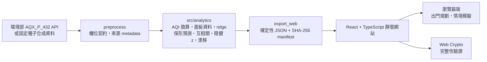

# Taiwan Air Lab — 台灣空氣實驗室

[](https://github.com/Lily09-project/aqi-anomaly-dashboard/actions/workflows/quality.yml)
[](https://github.com/Lily09-project/aqi-anomaly-dashboard/actions/workflows/security.yml)

> 空氣會移動，預報也該說出它的不確定性。這是一個把空品資料變成「可以驗證的分析」的實驗室：機率預報與出門時段規劃、污染從哪裡來、異常是局部還是區域、以及每個方法到底準不準。

**[▶ 開啟線上實驗室](https://lily09-project.github.io/aqi-anomaly-dashboard/)**：純靜態網站，不需登入、不需伺服器，模型直接在瀏覽器裡計算。


## 為什麼做這個

一般的空品儀表板只告訴你「現在幾分」。真正想知道的是：**接下來幾小時會不會變糟、什麼時候出門最安全、這波污染是從上游飄來的還是附近有人在燒東西**，以及「這些預測可信嗎？」。

這個專案最大的不同是**可驗證**：展示站使用固定種子的合成資料，刻意放進「西部污染團依序延遲抵達」與「14 個局部污染事件」兩種已知答案。分析程式不知道答案，網站卻會把偵測結果和真實答案並排公開，讓每個方法都接受檢驗。

## 六個功能

| 功能 | 回答的問題 | 方法 | 驗證結果 |
| --- | --- | --- | --- |
| **機率預報 + 出門規劃** | 未來 24 小時會多糟？哪 3 小時最適合運動？ | 每個時距一個 ridge 迴歸（直接多步），以校準期殘差做分割式保形預測得 P10／P50／P90；由分位數建分段線性 CDF，計算每個時段的超標機率並找出風險最低的連續時段 | 測試期 80% 區間實際覆蓋 83–91%；24/24 個時距優於持續性基準 |
| **污染傳播追蹤** | 誰是我的上游預警站？延遲幾小時？ | 去季節化後計算 1–12 小時落後互相關，必須同時超過門檻且優於同時相關；可暫停、逐步的事件重播（遵守 reduced-motion） | 14/14 條關係的延遲誤差 ≤ 1 小時；東部測站沒有被誤判 |
| **異常歸因 + 相似事件** | 為什麼異常？是局部還是區域？以前發生過類似的嗎？ | 測站 × 時段的中位數與 MAD 穩健 z 分數；以傳播延遲為窗口判斷其他測站是否同時異常；z 分數向量的最近鄰 | 注入事件召回率 100%、「局部」精確率 100%；3 個與區域污染團重疊的事件被歸為區域，網站公開揭露 |
| **情境模擬** | 如果風變大、或臭氧升高，下一小時會怎樣？ | 匯出可解釋的線性模型係數，在瀏覽器即時推論，附 80% 區間、各條件貢獻與單變數掃描 | TypeScript 與 Python 對 12 組案例誤差 < 10⁻⁶ |
| **模型監控** | 模型在沒看過的資料上表現如何？哪裡不行？ | 時間切分的訓練／校準／測試、與持續性及氣候值基準比較、覆蓋率校準、上游特徵消融、PM2.5 分布漂移 | 誠實顯示：第 24 小時未贏過氣候值基準；上游特徵只在 1–6 小時有約 2.6% 幫助 |
| **資料可信度** | 這些數字從哪來？有沒有被竄改？ | 確定性匯出 + manifest，瀏覽器以 Web Crypto 重算 SHA-256；公開種子、輸入雜湊與注入的已知答案 | 連跑兩次輸出位元組完全相同（CI 檢查） |

<table>
  <tr>
    <td></td>
    <td></td>
  </tr>
  <tr>
    <td></td>
    <td></td>
  </tr>
  <tr>
    <td></td>
    <td></td>
  </tr>
</table>

## 架構



- **資料科學**：所有方法在 `src/analytics/` 以 numpy／pandas 自行實作（ridge、保形預測、互相關、穩健 z、kNN），每個都有單元測試與「能否找回已知答案」的合成資料測試。
- **後端工程**：一條指令重建資料、分析與匯出；匯出不讀系統時間、鍵排序、固定位數，CI 連跑兩次並 `diff`。API 模式有 HTTPS 限制、逾時、回應大小上限與安全的 fallback 標示。
- **前端**：React 19 + TypeScript + Vite、d3-scale 手寫 SVG（依容器寬度量測，手機與桌面文字一致）、Hash 路由讓篩選與重播進度都能分享、淺色／深色主題、頁面延遲載入；首屏 JS 86 KB（gzip）。
- **可及性與安全**：每張圖都有等價資料表、地圖測站是可聚焦的連結、純鍵盤可操作、axe-core 零 serious/critical；嚴格 CSP、無 inline script、執行期不呼叫第三方、CSV 匯出防公式注入。

## 本機啟動

需求：Python 3.12、Node.js 22。

**Windows**

```powershell
git clone https://github.com/Lily09-project/aqi-anomaly-dashboard.git
cd aqi-anomaly-dashboard
.\run_project.bat            # 產生資料、跑測試、建置並開啟 http://127.0.0.1:4173
.\run_project.bat --validate # 只跑全部檢查，不啟動網站
```

**macOS／Linux**

```bash
python3.12 -m venv .venv
.venv/bin/pip install -r requirements.txt -c requirements-lock-py312.txt
.venv/bin/python run_all.py --mode sample     # 合成資料 → 分析 → web/public/data
cd web && npm ci && npm run build && npm run preview
```

`--mode api` 會改用環境部 API（`AQI_API_URL`、`AQI_API_KEY` 只放在未追蹤的 `.env` 或平台 secret store）；失敗時自動退回合成資料並在網站標示。

## 測試與驗收

驗收標準在重做開始前就訂在 [docs/ACCEPTANCE.md](docs/ACCEPTANCE.md)，每一項都對應自動化測試：

| 層級 | 指令 | 標準 |
| --- | --- | --- |
| Python 分析 | `python -W error -m pytest -q --cov=src.analytics --cov=src.export_web --cov-fail-under=90` | 全數通過；分析與匯出覆蓋率 ≥ 90%（目前 99%） |
| 前端邏輯 | `npm run typecheck && npm run lint && npm run coverage` | 0 錯誤；`web/src/lib` 覆蓋率 ≥ 85%；含 TS／Python 情境模型一致性測試 |
| 端對端 | `npm run e2e` | 4 種組合（1440 淺色／深色、768、390）× 7 個使用者旅程與品質檢查，含 axe、鍵盤、reduced-motion、0 console error |
| 效能 | `npm run size` | 首屏 JS ≤ 200 KB、首屏資料 ≤ 800 KB |
| 安全 | `ruff`、`bandit`、`pip-audit`、`npm audit`、gitleaks | 無問題 |

## 限制

- AQI 以逐時濃度換算（官方使用移動平均），數值會與環境部公告略有差異。
- 合成資料讓方法可以被驗證，但真實資料的雜訊、缺值與測站維修會讓表現變差；切換 API 模式後「真實答案」欄位會顯示「—」。
- 情境模擬是條件相關的線性模型，不代表因果。
- 不是即時監測，也不是官方預報或健康建議；健康決策請以環境部即時資訊為準。

方法細節見 [docs/METHODS.md](docs/METHODS.md)，資料來源契約見 [docs/data-contract.md](docs/data-contract.md)，部署與維運見 [docs/deployment.md](docs/deployment.md)、[docs/operations-checklist.md](docs/operations-checklist.md)、[docs/GITHUB_PAGES.md](docs/GITHUB_PAGES.md)，安全通報見 [SECURITY.md](SECURITY.md)。

## 公開儲存庫政策

可公開追蹤：程式碼、測試、設定、文件與介面截圖。
永不追蹤：`data/` 內的 CSV、`reports/metrics/` 的執行期 JSON、`web/public/data/` 匯出檔、`web/dist/` 建置產物、`.env`、金鑰與憑證、`node_modules/` 與本機暫存。
