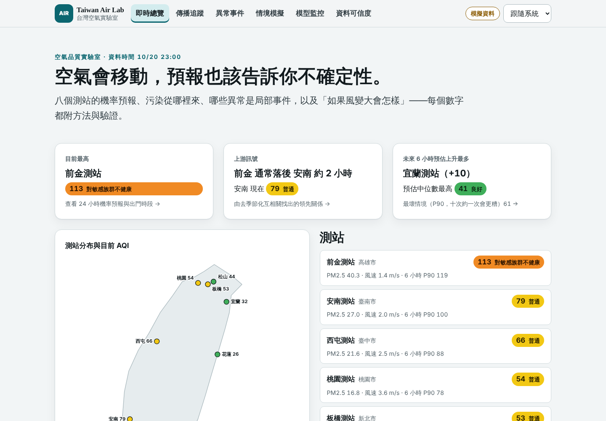
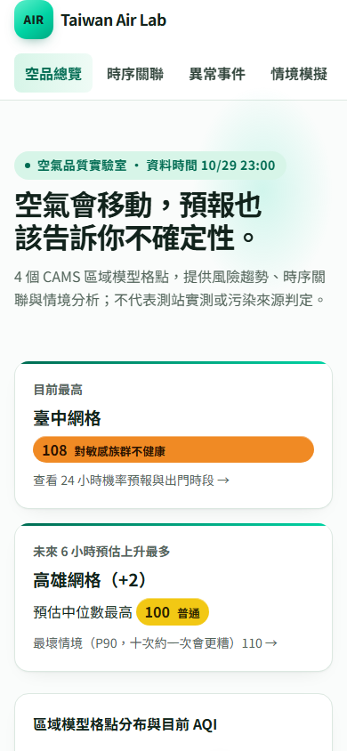
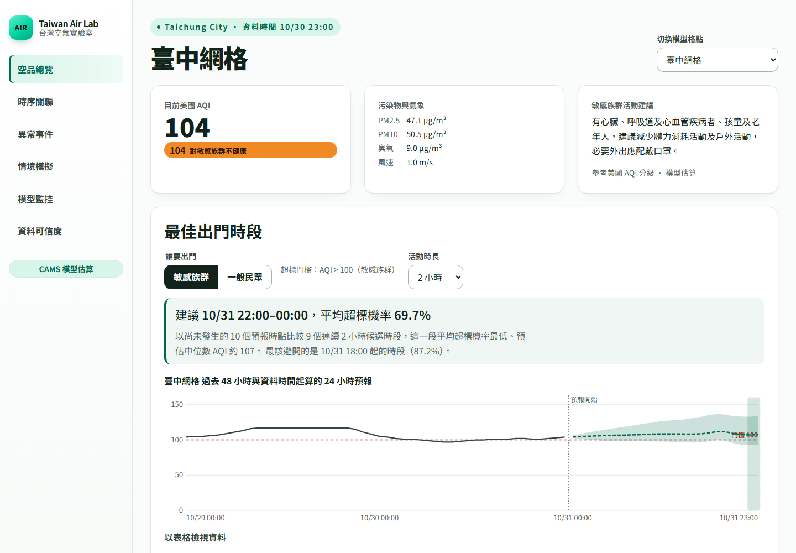
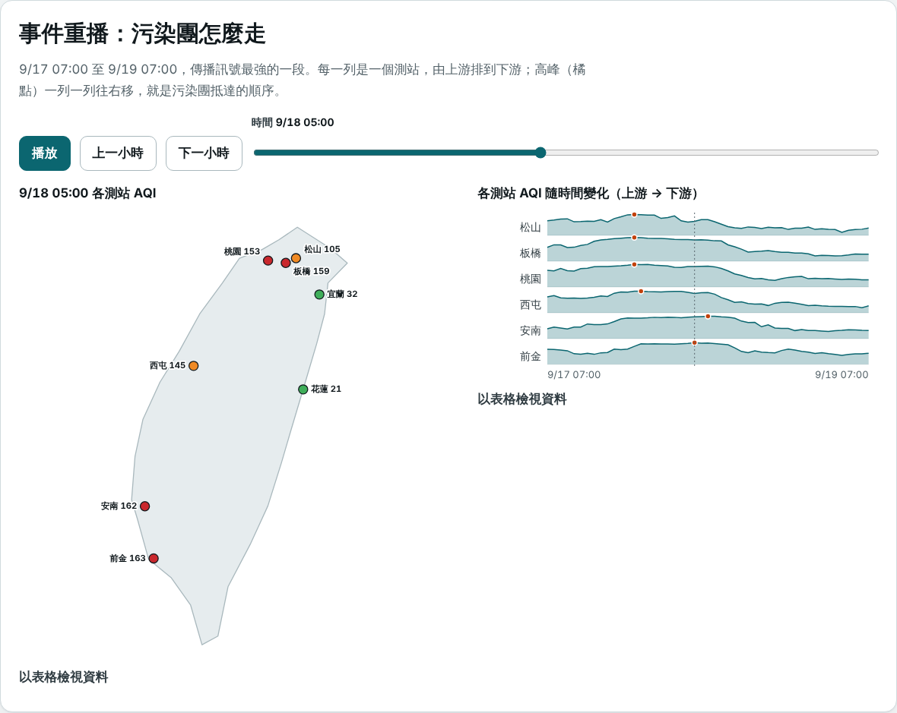
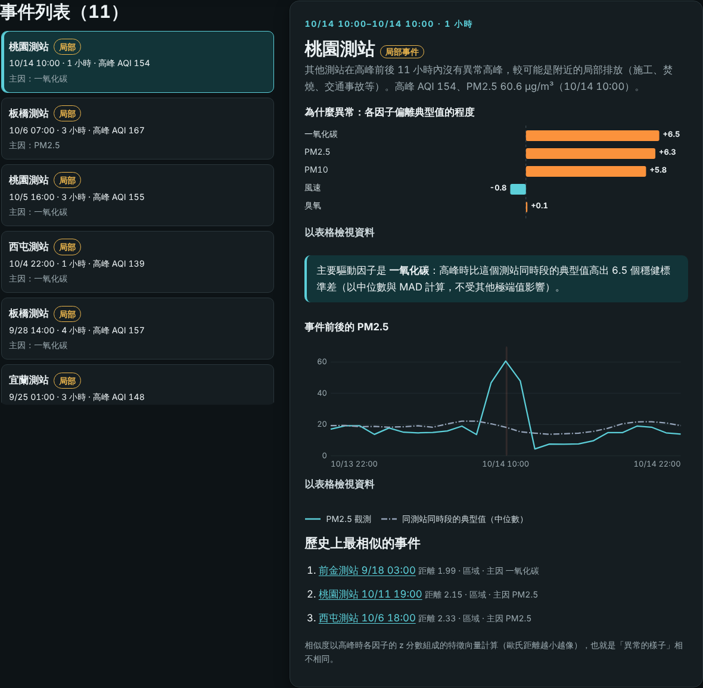
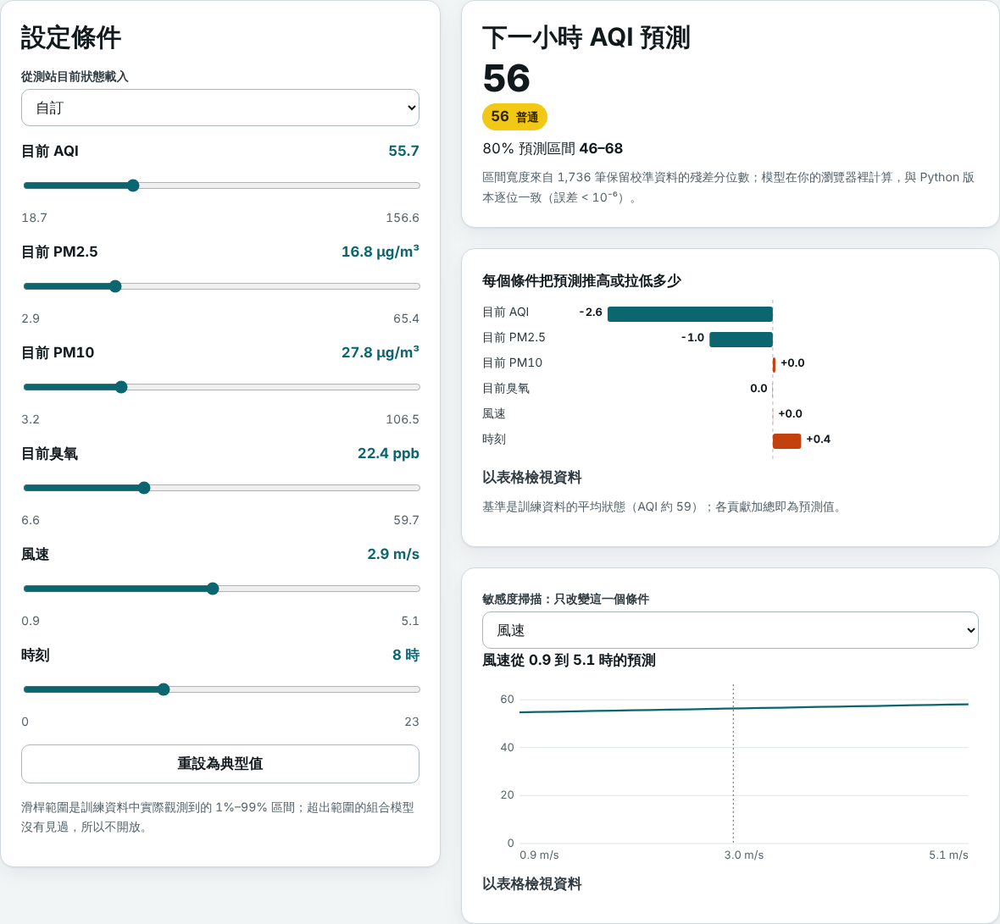

# Taiwan Air Lab

[](https://github.com/Lily09-project/aqi-anomaly-dashboard/actions/workflows/quality.yml)
[](https://github.com/Lily09-project/aqi-anomaly-dashboard/actions/workflows/security.yml)

臺灣空品趨勢、異常與情境分析展示網站。

**[開啟線上展示](https://lily09-project.github.io/aqi-anomaly-dashboard/)**

| 桌面版 | 手機版 |
| --- | --- |
|  |  |

## 正式資料

- 空品使用免註冊的 [Open-Meteo Air Quality API](https://open-meteo.com/en/docs/air-quality-api) 與 CAMS Global 模型資料。
- CAMS Global 約 45 公里網格、原生每 3 小時資料，約每 12 小時更新；API 逐時輸出含插值。風場來自 Open-Meteo Forecast API。
- 這是模型估算，不是環境部測站實測或即時健康警示。正式部署驗證公開來源；合成資料只用於測試與預覽。
- Open-Meteo 免費使用限非商業用途，依 CC BY 4.0 標示 Open-Meteo 與 CAMS。

## 功能與技術

提供臺灣多區模型格點、24 小時趨勢、地點比較、異常分析與瀏覽器端情境工具。使用 Python 資料流程、React、TypeScript 與 Vite。介面採薄荷色閱讀工作區與桌面側邊導覽，設計原則見 [DESIGN.md](DESIGN.md)。

## 畫面

| 出門時段規劃 | 時序關聯回放 |
| --- | --- |
|  |  |
| **異常事件與相關因子** | **情境模擬** |
|  |  |

截圖取自正式網站的 CAMS 模型估算資料。

## 本機執行與驗證

需求：Python 3.12、Node.js 22。

```bash
python -m pip install -r requirements.txt -c requirements-lock-py312.txt
python run_all.py --mode sample
cd web && npm ci && npm run dev
```

公開模型資料使用 `python run_all.py --mode api --require-api`。測試與部署說明見[資料契約](docs/data-contract.md)、[GitHub Pages](docs/GITHUB_PAGES.md)及[部署指南](docs/deployment.md)。使用條款見[Open-Meteo 官方說明](https://open-meteo.com/en/terms)。
